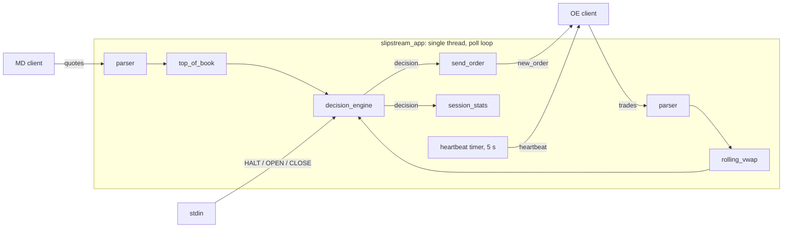

# slipstream

A single-instrument trading server in C++23. It consumes a market data feed and a trade feed over TCP, maintains a top-of-book and a time-windowed rolling VWAP, and on every trade decides whether to send an order: BUY when the ask trades at least `band` below VWAP, SELL when the bid trades at least `band` above it, subject to warm-up, size, and participation-cap checks.

## Architecture



| Component | File | Role |
|---|---|---|
| Wire protocol | `include/codec/protocol.h` | Packed binary frames: 4-byte header (`body_len`, `msg_type`, `version`) + fixed-size body |
| Parser / decoder | `include/codec/parser.h`, `decoder.h` | Reassembles frames from the TCP byte stream; any malformed frame drops the connection |
| Top of book | `include/server/top_of_book.h` | L1 book: best bid/ask price and size |
| Rolling VWAP | `include/server/rolling_vwap.h` | Fixed-capacity power-of-two ring buffer, time-based eviction, `__int128` accumulator |
| Decision engine | `include/server/decision_engine.h` | Pure logic, no I/O: events in, `decision` out |
| Session stats | `include/server/session_stats.h` | Execution report printed at shutdown |
| Server | `include/server/slipstream_server.h` | Owns sockets, the `poll()` loop, order sending, heartbeats |
| Client harness | `include/client/harness.h` | Replays a CSV over MD and OE connections at recorded pace, prints orders received |

### Message types

| `msg_type` | Message | Direction |
|---|---|---|
| 1 | `quote_body` | client → server (MD) |
| 2 | `trade_body` | client → server (OE) |
| 3 | `heartbeat_body` | server → client (OE), every 5 s |
| 10 | `new_order` | server → client (OE), one per decision, status `A`/`R` |

### Decision pipeline

Checks run in order; the first failure rejects:

1. **halted:** operator typed `HALT`
2. **warming_up:** no VWAP yet, less than one full window since the first trade, fewer than 10 quotes, or no valid book
3. **no_signal:** BUY needs `ask × 10⁴ ≤ VWAP × (10⁴ − band_bps)`; SELL needs `bid × 10⁴ ≥ VWAP × (10⁴ + band_bps)`
4. **zero_quantity:** `min(max_quantity, size at the touch)` is 0
5. **over_participation_cap:** `(our_volume + qty) × 10⁴ > cap_bps × market_volume`
6. **accepted:** limit price is the touch (ask for BUY, bid for SELL)

### Design decisions

- **Fixed-point prices.** Prices are `int64_t` scaled by 10⁴; no floating point on the hot path. Band and cap math is rearranged to multiply instead of divide, so there is no rounding.
- **Single-threaded `poll()` loop.** MD, OE, and stdin are multiplexed on one thread, so book, VWAP, and engine state need no locks.
- **Engine does no I/O.** The server owns the book and VWAP and passes them in by `const&`; the engine returns a `decision` and the server turns it into wire bytes. This makes the engine unit-testable without sockets and transport-independent.
- **Event time, not wall time.** The engine's warm-up clock uses trade timestamps, so replays are deterministic at any speed.
- **Fail-safe disconnects.** `SIGPIPE` is ignored and send failures surface as exceptions handled per thread, so a disconnect is a logged event rather than a crash.

## Build

```
cmake -S . -B build -DCMAKE_BUILD_TYPE=Debug
cmake --build build && ctest --test-dir build --output-on-failure
```

Use `-DCMAKE_BUILD_TYPE=Release` (in a separate build directory) for any latency measurement.

## Run

Server:

```
./build/slipstream_app --symbol SYNTH4 --md-port 9000 --oe-port 9001 \
    --vwap-window-ms 5000 --band 0.0005 --participation-cap 0.1 --max-quantity 100
```

| Flag | Meaning |
|---|---|
| `--symbol` | Instrument to trade (required); other symbols are counted and dropped |
| `--md-port`, `--oe-port` | Listening ports |
| `--vwap-window-ms` | VWAP lookback window |
| `--band` | Signal threshold as a decimal fraction (`0.0005` = 5 bp) |
| `--participation-cap` | Max fraction of market volume we may trade (`0.1` = 10%) |
| `--max-quantity` | Max order size |

Client (replays the CSV in real time, so the full sample file takes about an hour):

```
./build/slipstream_client 127.0.0.1 9000 9001 data/Quotes_and_Trades.csv
```

Operator commands on the server's stdin: `HALT` (reject all decisions), `OPEN` (resume), `CLOSE` (shut down). On shutdown the server prints an execution report: decisions, accepted quantity, market quantity, participation, and a count per reject reason.

## Latency

### Methodology

**Tick-to-order** is measured inside `slipstream_app` with `std::chrono::steady_clock`:

- **Start:** immediately after `recv()` returns bytes on the OE socket, before parsing
- **Stop:** immediately after `send()` returns for the resulting `new_order`

Caveats:

- When one `recv()` returns several messages, they share a start time. Later messages include time spent handling earlier ones. This is real queueing delay and is intentionally included.
- `send()` returning means the bytes are in the kernel's socket buffer, not on the wire. Wire-to-wire measurement would need NIC hardware timestamps.
- Console output in the handler is inside the measured window for subsequent messages in the same batch.

### Results

| Configuration | n | p50 | p99 | p99.9 | Notes |
|---|---|---|---|---|---|
| Debug, real-time replay | 6 | ~60 µs | n/a | n/a | Unoptimized build, cold caches between trades; baseline only |
| Release, real-time replay | | | | | |
| Release, no-sleep replay | | | | | Warm caches |
| Release, no-sleep, console output off | | | | | |

Samples are kept in a preallocated buffer (no allocation on the hot path); percentiles are computed by sorting at shutdown (nearest-rank).

## Further measurement plan

- **Jitter:** distribution width and inter-arrival times, not just percentiles
- **Component tracing:** parse, decide, and serialize/send broken out separately
- **Throughput:** sustained and burst message rates (5×, 10× normal load), and latency behavior as load rises
- **Resources:** CPU, memory, context switches on the hot path
